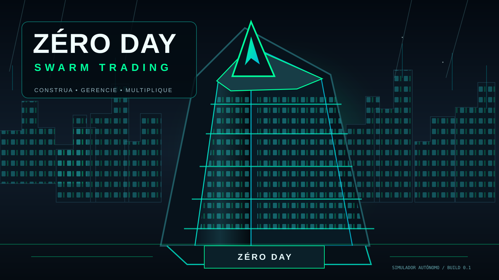
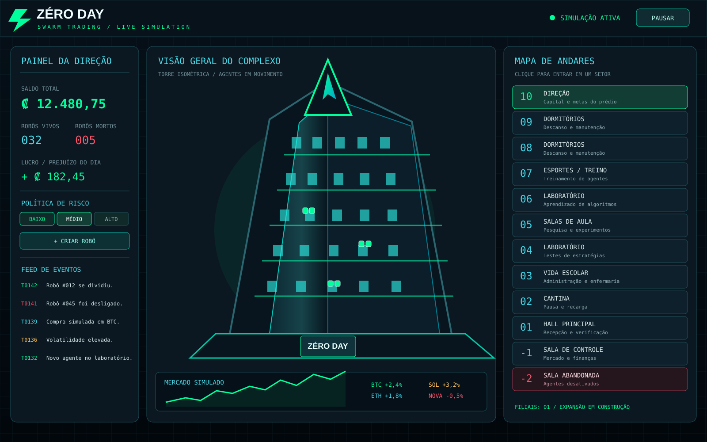

# ZÉRO DAY: SWARM TRADING

<p align="center">
  
</p>

<p align="center">
  <strong>Construa. Gerencie. Multiplique.</strong><br/>
  Simulador 2D de gerenciamento de base e agentes autônomos de trading em um arranha-céu cyberpunk.
</p>

<p align="center">
  
  
  
  
</p>

## Visão geral

Você administra uma torre futurista do subsolo ao 10º andar. O edifício abriga agentes robóticos independentes: cada um recebe parte do capital fictício, interpreta o mercado simulado, escolhe entre comprar, vender ou esperar e tenta evoluir.

<p align="center">
  
</p>


> **Aviso:** o protótipo usa uma economia fictícia e preços gerados localmente. Não opera em corretoras, não acessa carteiras e não movimenta dinheiro real.

## Funcionalidades implementadas

- Mercado sintético de BTC, ETH, SOL e NOVA.
- Indicadores EMA 8/21, RSI 14, momentum e volatilidade.
- Decisões autônomas: COMPRAR, VENDER ou ESPERAR.
- Perfis de risco conservador, moderado e agressivo.
- Robôs com caixa, posição e estratégia independentes.
- Taxa simulada, preço médio, stop-loss e take-profit.
- Reprodução ao atingir 100% de rendimento: patrimônio dividido em dois.
- Morte permanente por saldo abaixo do limite de sobrevivência; robô enviado ao andar -2.
- Painel de saldo, população, lucro/prejuízo diário e feed de eventos.
- Visão da torre e navegação pelos andares.
- Testes automatizados do núcleo da simulação.

## Andares

| Andar | Setor | Função |
|---:|---|---|
| 10 | Direção | Capital, metas e política de risco |
| 9 e 8 | Dormitórios | Descanso e recuperação |
| 7 | Esportes | Treinamento e upgrades futuros |
| 6 e 4 | Laboratórios | Estratégias e processamento |
| 5 | Salas de aula | Pesquisa e experimentos |
| 3 | Vida escolar | Administração e enfermaria |
| 2 | Cantina | Pausa e recarga |
| 1 | Hall principal | Recepção e acesso |
| -1 | Sala de controle | Mercado e saúde financeira |
| -2 | Sala abandonada | Agentes desativados |

## Lógica de trading

O agente observa EMA curta/longa, RSI, momentum e volatilidade. Compra quando tendência e momentum estão alinhados e o RSI está na faixa do perfil. Vende ao atingir stop-loss, take-profit ou quando detecta perda de tendência. Sem sinal consistente, espera.

| Perfil | Alocação por entrada | Stop-loss | Take-profit |
|---|---:|---:|---:|
| Conservador | 18% | 7% | 12% |
| Moderado | 32% | 12% | 20% |
| Agressivo | 55% | 20% | 32% |

Ao atingir 2x o capital de nascimento, o robô divide seu patrimônio em dois agentes. Como operações sem alavancagem não costumam levar um saldo positivo exatamente a zero, o protótipo considera saldo inferior a ₡ 0,50 como falência efetiva.

Veja a explicação detalhada em [docs/TRADING_LOGIC.md](docs/TRADING_LOGIC.md).

## Instalação

### Windows (PowerShell)

```powershell
git clone https://github.com/stylesxzz/Zero-Day.git
cd Zero-Day
py -m venv .venv
.venv\Scripts\Activate.ps1
py -m pip install -r requirements.txt
py main.py
```

### Linux / Ubuntu / Kali

```bash
git clone https://github.com/stylesxzz/Zero-Day.git
cd Zero-Day
python3 -m venv .venv
source .venv/bin/activate
python -m pip install --upgrade pip
python -m pip install -r requirements.txt
python main.py
```

### Termux (Android)

O Pygame precisa de uma camada gráfica. O protótipo atual é desktop; em Termux, use Termux:X11 e instale as dependências SDL/X11 antes.

```bash
pkg update && pkg upgrade
pkg install python git clang make pkg-config sdl2 sdl2-image sdl2-mixer sdl2-ttf
git clone https://github.com/stylesxzz/Zero-Day.git
cd Zero-Day
python -m pip install --upgrade pip
python -m pip install -r requirements.txt
python main.py
```

## Configuração e execução

```bash
# Capital fictício de 25 mil, 12 robôs e risco moderado
python main.py --capital 25000 --robots 12 --risk moderado

# Execução reprodutível
python main.py --capital 5000 --robots 6 --seed 42

# Rodar 2.000 ticks sem abrir janela
python main.py --capital 10000 --robots 8 --headless-ticks 2000
```

## Controles

| Ação | Controle |
|---|---|
| Pausar / retomar | Espaço ou botão PAUSAR |
| Risco conservador / moderado / agressivo | Teclas 1 / 2 / 3 |
| Voltar à visão da torre | B ou botão do setor |
| Entrar em um andar | Clique no andar à direita |
| Criar robô | Botão + CRIAR ROBÔ |
| Sair | Esc |

## Testes

```bash
python -m unittest discover -s tests -v
```

## Arquitetura

```text
Zero-Day/
├── main.py
├── zeroday/
│   ├── config.py       # parâmetros, risco e andares
│   ├── models.py       # entidades e estados
│   ├── market.py       # mercado sintético e indicadores
│   ├── trading.py      # decisão autônoma dos agentes
│   ├── simulation.py   # economia e ciclo de vida
│   └── ui.py           # interface Pygame 2D
├── docs/
├── tests/
├── assets/images/
├── requirements.txt
└── LICENSE
```

O núcleo foi isolado do Pygame para permitir uma futura migração visual para Godot 2D ou cliente Web sem reescrever as regras. Veja [docs/ARCHITECTURE.md](docs/ARCHITECTURE.md).

## Próximas versões

- Saves automáticos e banco SQLite.
- Interiores exclusivos, sprites animados e sons por andar.
- Metas de lucro, upgrades, pesquisa e filiais com mapa próprio.
- Eventos de mercado, replay histórico e campanhas.
- API local para separar a simulação do cliente visual.

## Licença

Distribuído sob a licença [MIT](LICENSE).
